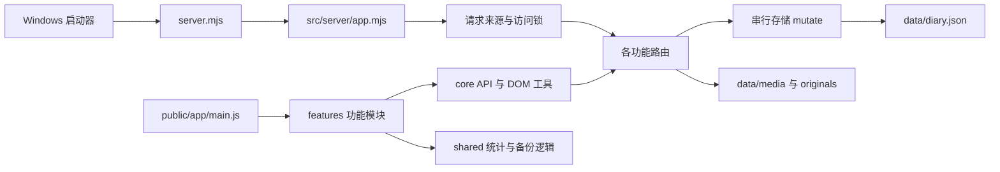

# 架构说明

## 运行边界

Windows exe 负责找到 Node.js、启动根目录 server.mjs、打开浏览器。浏览器使用原生 ES modules，无打包器、无运行期 npm 依赖。Node 只监听回环地址，负责日记库、文件与本地访问锁；浏览器负责编辑、显示以及新备份的压缩加解密。

## 后端

- `app.mjs` 是组合入口：创建存储、访问锁、路由队列；统一错误处理。根 `server.mjs` 仅负责命令行启动与稳定导出。
- `storage/library-store.mjs` 独占数据库的内存状态。每次写入串行排队、structuredClone、临时文件落盘、rename，再替换内存状态。回调必须同步，抛错不提交；不可直接改 getDb() 返回值。
- `domain/entries.mjs` 只校验和规范化日记输入。API 当前接收完整可编辑对象，不是通用 JSON Patch。
- `routes/` 按领域注册：entries、settings、organization、media、imports、backups、legacy-backups、static。每个模块只拥有自己的路由；依赖通过上下文注入。
- `imports/` 只处理旧格式和 ZIP 读取；原始格式材料在 resources/legacy 内，不再依赖项目外的 scripts 目录。
- `security/access.mjs` 在所有业务路由前运行。添加新接口不得绕过访问锁。备份路径不是公开下载目录，需经 API 鉴权。

路由契约：`async (req, res, pathname) => boolean`。已响应返回 true；流式 pipe 后也必须返回 true；未匹配返回 false。错误用 `throw fail(status, message)`。http.mjs 负责响应和统一异常提示。

## 前端

- `app/main.js` 协调当前日记、筛选、自动保存、编辑器选区与主视图事件。这里仍有协调代码；后续拆分时优先建立清晰接口，不引入多个互相写同一状态的副本。
- `features/index.js` 显式创建各功能模块并安装菜单、工具栏和附加视图。它是增删界面功能的主要装配点。
- 每个 feature 工厂拥有自己的临时状态，通过 `FeatureContext` 调用 API、保存、刷新、弹窗与编辑器。`public/core/contracts.js` 有字段说明。`c.library` 是 getter，刷新后仍指向最新库；构造时解构缓存 library 会产生陈旧数据。
- `core/` 只放通用工具。DOM 清洗、可见文本提取、HTML转义统一在 dom.js，避免统计和显示各自使用不同口径。
- `shared/` 放可独立测试的算法与协议；模块尽量不在导入时触碰 DOM。Node 读取其中的快捷键目录和容量常量，浏览器不会反向读取 src/server。
- CSS按原顺序拆分为 foundation、editor、views、dialogs、responsive、shortcuts、features、theme-print。`public/style.css` 的导入顺序就是覆盖顺序，不可随意调换。

## 暂时保留的技术限制

工作库仍是整体 JSON，保存会复制与重写整个库；分块备份解决大附件处理，不能消除大元数据的内存成本。新旧两套备份协议并存；删除旧入口前必须考虑已有文件的恢复。富文本仍使用浏览器编辑命令，未来替换编辑器需兼容旧 HTML 和历史记录。界面视觉整体重做、增量同步和数据库升级属于后续独立变更。

## 0.5 装配与隔离

appearance、layout、context-menu 在 features/index 显式安装，各自管理界面状态与 CSS。entry-actions 通过主协调器 withLibraryMutation 等待草稿保存，暂时禁止编辑区输入，按目标 ID 与 revision 写入并刷新。背景复用媒体与加密备份底层，不新建第二套文件加密协议。appearance-compat 仅在服务创建时兼容旧背景，保留原件。样式新增三层放在 theme-print 后，新增背景规则显式排除打印。

## 0.6 结构

编辑核心现在在 public/editor 下独立管理；统计纯函数在 shared/statistics.js，周期回忆在 shared/recall.js；分类、模板和偏好分别使用各自后端路由。上传交互、冲突比较各为独立功能模块。完整职责表见 ITERATION-0.6.md。app/main.js 仍负责页面导航、列表、日历等组合流程，不代表所有界面都已拆成独立包。
