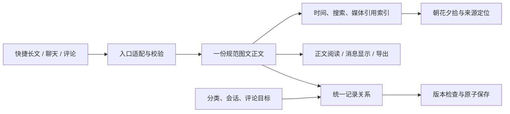

# 统一内容处理：正文、时间与媒体引用

2026-10-16 时间粒度补充确认：朝花夕拾要按单条可回看单元筛选，覆盖纯文字、图片、视频及图/视频配文字，不能仅使用整篇Entry日期。当前事实：legacy-time-segments可识别完整手打时间及hardBreak分行并继承至下一时间锚点，旧候选验证保留2290/2290完整锚点；正式新长文仍仅保存原时间文字，未接统一逐条时间索引。新文中图片/视频每次出现已有insertedAt，历史未知仍null；图片时间与所在文字内容时间须并存，不能相互替代。实现建议：时间戳区间作为长文回看分组，混排由一个单元包含多个内容块，媒体保留自身插入时间；此分组/统一查询尚未上线。稳定entryId/blockId/occurrenceId（及未来单元ID）负责定位与评论，时间负责筛选；版本内偏移不作为永久评论ID。无明确正文时间使用既有内容编辑时间兜底并注明来源，分类/标签操作不推进内容时间；旧媒体插入时间无法凭空恢复。

2026-10-16 当前增量：全部旧篇在独立候选包完成首轮处理，旧库未写；新图文已接入显式开发快捷窗及Entry安全保存。手打时间使用扩展段内temporal（包含hardBreak），不能把下文初版顶层blocks的单一时间当作长文完整索引；正文/图片时钟独立。派生索引尚未与正式保存事务一起落库，聊天和朝花夕拾后议。使用 QUICK-RICHDOC-CANDIDATE.md，验证见 validation/2026-10-16-full-conversion-quick-richdoc.md。

2026-10-16 最新候选实现：独立旧篇转换器已落实附件置顶、已保存HTML换行语义保留，并由 legacy-time-segments 扩展段内时间。700篇独立副本（200开发/500盲测）622明确时间全覆盖，8篇例外保留复核；完整项目388项检查通过。旧快捷窗未替换，独立服务启动受阻，已有私有离线对照页。见 validation/2026-10-16-legacy-conversion-expanded.md；下文“尚未实施新规则”是此前讨论快照。

2026-10-16 用户确认转换副本中的旧附件默认放正文开头、沿原列表顺序，insertedAt 保持未知，位置来源标记为 legacy-default-start。转换与独立校验、固定失败集/新随机盲测/批量例外队列的方案见 LEGACY-CONVERSION-ITERATION-PLAN.md。当前处理器/旧格式适配尚未实施该新规则，不把此前“附件位置未知”误当必须保留原附件区的用户决定。

2026-10-16 首轮真实抽样发现接入前问题：35 篇原对象未变、候选处理往返通过，但旧 Markdown 换行/段内时间与独立附件清单存在差异。完整时间覆盖为 98/109，不能以纯模块测试通过代替旧数据兼容；见 [真实抽样](validation/2026-10-16-real-diary-sample.md)。本轮仅试验/文档，不改运行算法或迁移旧库。

2026-10-16 本轮兼容补充：processorVersion 升至 2，新增可选 contentEditedAt，避免分类/标签修改刷新长文的兜底内容时间；未接入正式保存。每次准备复用一次解析的时区，减少长文重复计算。旧格式/属性/聊天接口和快捷窗 UI 的完整边界见 [前端兼容合同](FRONTEND-DATA-COMPATIBILITY.md)，后续先满足该合同再装配。

状态：2026-10-16 第一版纯处理器已实现，尚未接入正式保存、旧格式转换或快捷窗口。代码为 `public/shared/content-preparation.js`，可在 Node 和浏览器共用；没有数据库、文件和网络读写，不调用模型。虚构处理结果在 `outputs/content-preparation/example.json`。

验证：针对性 14/14 与完整 npm run check 的 348/348 测试通过；详细范围、证据和未接入部分见 [验收记录](validation/2026-10-16-content-preparation.md)。

用户本轮确认继续设计“编辑后的文本处理成通用格式，供存储和后续使用”。沿用既定顺序：共享富文档与图片适配 → 基础数据接口 → 朝花夕拾。当前不改另一个会话的 UI，不迁移旧库。

## 1. 存什么，什么可以重建

| 数据层   | 权威内容                                                       | 后续用途                                   |
| -------- | -------------------------------------------------------------- | ------------------------------------------ |
| Record   | 记录身份、类型、分类、会话、版本、可见性、引用/评论关系        | 决定内容是谁、属于哪里、能否修改           |
| Document | 一份 shiye-richdoc 正文，保留段落/格式/图片顺序和稳定身份      | 写作、聊天显示、阅读与导出共同使用         |
| Asset    | 实际原图/附件字节、资源 ID、哈希等；图片出现节点保存位置与排版 | 同文件复用，不复制压缩正文里的图片         |
| 派生索引 | 时间关联、搜索文本、资源引用、来源版本和算法版本               | 可删除后重建，不作为另一份可独立编辑的正文 |

JSON 是可携带的逻辑格式，不要求全库变成一个不断膨胀的大正文 JSON。现有文件存储可以先适配，物理数据库后续再定。五小时归篇只决定聊天消息如何组成可读的一篇，不决定消息的基本格式，也不复制生成可编辑长篇正文。

## 2. 当前纯处理器输入输出

`prepareContent` 接收已经通过图文编辑器生成的 body，以及 recordId、revision、kind、state、visibility、时间依据和可选资源 ID 清单。它不创建分类/会话/记录 ID，不从用户名或文章内容猜归属；外围 Record 由适配器原样维护。

返回 `shiye-prepared-content` 是**候选保存前的处理结果**，不是另起一套最终 Record 格式，也不是现有设计 schema 已经接受的新持久字段。其 `body` 是输入正文的深复制，`source` 标记身份和版本；`derived` 提供派生信息，`warnings` 仅含问题码和内容块 ID，不重复记录正文。

- `inputFingerprint`：对正文及相关身份/时间上下文计算确定性的 SHA-256；记录版本、时区或时间来源改变会失效，不能拿旧索引覆盖新版本。资源可用状态另检，不纳入正文指纹。处理器版本也必须参与缓存键。
- `blocks`：按现有正文顶层顺序，保存 blockId、内容时间与锚点 blockId；不重新拆篇或生成新的正文副本。
- `media`：保存 assetId、occurrenceId、图片 blockId、顶层归属、insertedAt 与内容关联时间。同图两次出现不会合并位置/评论身份。
- `plainText`：只供搜索等用途的派生纯文本，格式仍由原 body 保存。不能拿这份纯文本重新覆盖正文或作为 HTML 直接插入页面。
- `assetIds/missingAssetIds/assetsChecked`：检查关联清单，不读取文件字节。正式保存前仍须验证实际文件、大小、MIME 和哈希；缺资源不能通过删节点“修好”。
- `searchEligible/recallEligible`：默认排除隐藏/草稿/删除；评论不作为回看来源。它们不是权限授权，服务端仍需按当前访问状态过滤。

重复处理不插入新时间、不改块 ID、不重设图片时间、不改变原正文。未知格式/不支持的节点报错，原件留在调用方，不能改存空正文。当前模型还需要结构/编辑器能力检查；纯处理器通过不代表任意插件节点都已支持。

## 3. 第一版时间规则与限制

| 来源                     | 当前处理                                   | 依据与限制                                                                                            |
| ------------------------ | ------------------------------------------ | ----------------------------------------------------------------------------------------------------- |
| 长文独立完整日期时间段落 | 本段及之后顶层内容使用此锚点，直到下一锚点 | 支持斜线/横线/年月日及常见中英文括号；原文不改                                                        |
| 无锚点长文及首锚点前文字 | 使用显式传入的编辑时间，标记 edit-fallback | 来源可为 entry-updatedAt 或 legacy-updateTime；首锚点前兜底是本版实现建议，尚未替用户确认全部历史写法 |
| 消息                     | sentAt                                     | 正文提到往年日期不会改变发送时间                                                                      |
| 评论                     | createdAt                                  | 不自动参与朝花夕拾，不改评论目标                                                                      |
| 图片                     | insertedAt 与所在内容时间并存              | 未知插入时间保持 null，不用上传/拍摄/编辑时间冒充                                                     |

没有时间的旧篇按编辑时间兜底是用户已确认目标。旧安卓原始 updateTime 与当前 updatedAt 差异如何选择由读取适配器显式处理，本处理器不会隐式选一份或修改旧数据。既有只读统计发现 2915 篇原对象均有三组时间，3 篇原始/当前修改时间不同，见 validation/2026-10-16-diary-time-audit.md。

未注明时区的完整正文时间按显式选择的时区解释（缺省北京），保留 assumedZone 标记；选择“系统”时先冻结为实际 IANA 时区。按分钟写出的时间仍是分钟精度，不能因 UTC 字符串有 :00 就冒充秒级。非法日期、DST 不存在/重复时刻不静默修正；重复时刻检查覆盖常见 30/60/90/120 分钟偏移，不宣称处理全部历史时区特例。

代码/引用内的时间不当作正文锚点。仅时分、日期不完整或同段硬换行等情况保留原文并提示；检测到无法解析的新标记时停止沿用上一个锚点，以免误归时间。列表/表格内的锚点、本段混合多个时间、缺日期推断尚未实现，不能声称所有旧写法都能自动分段。历史 HTML/Markdown 也尚未由本处理器直接读取。

上述 edit-fallback/sourceField/assumedZone 等为处理结果的派生字段；统一 v1 草案的最终持久 eventTime 尚需在正式适配前补映射/版本约定。长文一个 Record 可对应多个块级时间，不能只留 Record 的一个时间而丢掉块级索引。

## 4. 正式保存应如何衔接

这是后续实施步骤，本轮未开放生产路由：

1. 保持旧快捷输入的时间戳、分割线、智能换行、图片确认及原保存队列。中文组词完成后取得一致编辑器快照，不能在 composition 中途处理 DOM；仍走原自动保存节奏。
2. 接入图文新篇时，由入口适配器提供规范 body、分类/会话等 Record 元数据和显式时间来源。旧篇仍走原兼容读取，不在每次打开时自动迁移。
3. 图片上传先得到持久资源 ID，再绑定正文图片出现。临时 blob URL/试验哈希不能直接冒充正式媒体 ID；上传或正文保存失败保留当前输入，不能提前收起窗口。
4. 处理器在串行提交前完成快照校验/异步指纹计算。服务端根据候选下一版本处理；进入 storage.mutate 时再次核对 expectedRevision，再同步发布正文、关系和匹配该版本的索引。**当前 mutate 回调不等待 Promise**，不能把本处理器异步调用直接放进该回调后假定已经完成。
5. revision 已改变则返回冲突，保留当前编辑状态。新建篇的稳定身份与首保存绑定继续按既有协议，不让并发生成两个篇目或误覆盖旧篇。
6. 正文渲染来自同一 body，HTML/Markdown 只作为阅读/导出投影。旧客户端不能理解新正文时只读降级，禁止经旧接口保存后丢失图片位置或新节点。
7. 备份导出同时保存记录关系、正文和可达资源；恢复时映射所有块中资源引用。完整原件恢复通过后才能开放正式存储，不以一份示例 JSON 替代完整媒体备份。

聊天撤回是独立业务操作：权威库先清除正文，处理器只接受 body=null 的撤回占位，输出空搜索/媒体引用与不可回看标记。它不能替代缓存、历史、引用摘要和导出中的原文清理。评论目标、跨篇汇总、五小时归篇和朝花夕拾查询继续由各自领域层处理。

## 5. 验证与下一接点

测试入口 `tests/content-preparation.test.mjs`，覆盖手打时间优先/编辑来源、未知时间、同图多次出现、重复处理、代码引用、无效/有歧义时间、原消息时间、撤回占位、版本指纹、未知节点、资源缺失、真实 Markdown 解析到 JSON 往返和可见性。

当前下一接点是隔离快捷窗口中的新篇 body 适配与最小保存/媒体接口，仍须满足 QUICK-RICHDOC-INHERITANCE.md 的 40 项基线；本轮不更换 UI、不新增回看功能、不全库转换。正式性能、实际保存冲突/恢复、中文 IME 和窗口生命周期尚待接入后验证。
