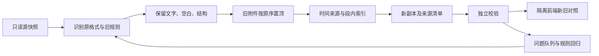

# 旧日记新副本转换与抽样迭代方案

2026-10-16 全量已执行到独立目录：3015条=3011旧日记＋4聊天canonical保留，2986正常、29复核、失败0；完整时间2290/2290，源库及library哈希复核一致。十月57条全部覆盖。源/候选不可覆盖、哈希续跑通过，旧库未切换；少数异常第二轮处理。见 validation/2026-10-16-full-conversion-quick-richdoc.md，下文700篇是前置抽样阶段。

2026-10-16 最新状态：用户授权实施并指定 gpt-6.1-sol、中等推理子代理，已并行完成格式/附件、时间索引、独立校验并生成 700 篇独立候选副本（200 开发＋500 盲测）。未使用 DSH、未全库转换或切换正式库。结果见 validation/2026-10-16-legacy-conversion-expanded.md；下文讨论时的建议由本段实际状态更新。

## 已确认的边界

1. 原始日记和媒体不改写，新结构独立生成一份，再回到隔离前端渲染/对照查看。
2. **旧附件默认置于正文开头，保持原附件列表顺序。** 图片作为正文图像，其他附件需对应可展示的资源节点/区域；长篇标题仍是独立标题，附件位于标题后的正文最前。具体间距/折叠外观后续前端适配，不擅改快捷窗整体布局。
3. 这个位置是用户新指定的转换规则，不是找回了历史位置。转换清单应标记 legacy-default-start；历史 insertedAt 仍为空，不补成转换时间。
4. 旧换行、时间写法不统一，按抽样、归纳、规则开发、独立校验、再次抽样、扩大批次的流程改进。小部分例外进入队列，保留原件/兼容阅读，不用删内容来通过验证。
5. 分类/标签等属性仍可变，评论和资源关联保留；格式转换与快捷窗/聊天基础接口接入分别验收。朝花夕拾不抢先实施。

## 1. 先做独立转换库

候选产物在项目私有 `var/migration-lab/<runId>/`，最终目录结构实施时定；正式源 data/ 原位不变。报告在 outputs/，临时脚本在 tmp/；可提交文档/虚构样本不含真实正文。

每次运行保存源快照摘要、逐条来源 ID/源 revision/源哈希、规则版本和 ID 映射。转换后的新 Record/Document、媒体索引、旧字段原件和评论关系是同一转换包的不同部分，不只输出一段新 JSON 正文。实际私有转换包可以含用户正文；当前 35 篇抽样报告仍只含匿名统计。

媒体可按需复制到私有试验库并校验哈希，或由明确只读解析器取原资源；不能让预览编辑操作修改共享原媒体。缺文件列异常，不伪造空图。完整导出/恢复时必须能带全媒体，不只依赖本机旧路径。

同一源记录在重试/重跑时复用已登记的身份映射；不能每次都生成新消息、新评论身份或重复插入附件。规则升级也不靠改标题/时间制造去重键。原篇在源库被修改时标记结果过期，按新版本重新转换，不把旧快照直接覆盖回去。

候选新库和正式库是两个数据集。若今后让用户在候选库继续写作，需另行确定增量/切换规则，不能把双库双向同步默认为已实现。

## 2. 转换流水线

### 换行/格式

分别适配旧 HTML、可信 Markdown 源码与 Android 原记录，不把它们统一按任意一个 Markdown 配置重新渲染。以当前原正文/原渲染语义为对照，保留段落、单换行、空段、全角缩进、列表/引用/代码及分割线。原始源码与规范正文不可作为两份可独立编辑的正文；来源副本用于迁移追溯。

原 Markdown 单换行与现有 parser breaks=false 的差异需要专门处理。允许在新树中用 hardBreak 或等价布局表达，但不允许删换行来让文字比较通过，也不能借转换把 --- 前文变成标题。表格/颜色等无法表达的节点/属性报告异常并保留原件，不静默丢弃。

### 附件

原附件列表按顺序生成正文开头的资源区域。图片区分 assetId 和 occurrenceId，源文件/附件 ID 映射写转换清单；已存在的文中图片保持原有位置。若列表和正文都引用同一文件，需根据已有出现身份/可确认的对应关系识别列表重复登记，不能仅凭相同 assetId 删除一次真实出现。无法确定重复关系时保留来源并列为待核对。

当前 richdoc 子集只有 image，video/audio/file 尚为模型设计范围；非图片附件先保留完整关联和兼容阅读区域，不把它们假装成 image，也不声称新节点已支持。资源索引须合并文中节点与独立附件，防止迁移/备份漏文件。

### 时间

输出同时保留原可见文字、解释结果、精度、来源和歧义标记，不通过改写原时间表达获得整齐数据。

- 完整日期时间：优先解释明确锚点；未注明时区按所选日记时区解释并标明推定，默认北京。代码/引用/句中提到往事不能仅凭正则当新写作锚点。
- 同段多个时间行：索引可以分段，正文段落和换行不必被拆改；位置需带来源版本，临时偏移不能作为永久评论身份。
- 只有时分：有可靠明确日期上下文时可形成有依据的组合结果；仅借篇目日期时属于候选推定，须标明并统计，不能静默变成高置信时间。时间倒退不能独自作为“跨到次日”的证据，用户可能后补旧事。
- 没有有效时间标记：按用户已确认的正文编辑时间来源兜底；属性 updatedAt 不替代正文时钟。原始/当前修改时间有分歧的记录单独排队，不自动全选转换日。
- 图片拍摄/文件修改/入库/插入时刻分开；旧图 insertedAt 未知仍为空，放到开头不改变其内容时间依据。

上述更细推定策略是本轮 AI 方案，尚需样本证明和异常核对，不当作用户已逐项确认。不能仅凭一个模型的置信评分通过迁移。

## 3. 校验器必须独立于转换器

| 层次       | 判定内容                                                          | 失败处理                                 |
| ---------- | ----------------------------------------------------------------- | ---------------------------------------- |
| 结构合法   | schema、节点嵌套、唯一 ID、表格/标记、版本、必需字段              | 不进入正常候选列表，保留原文和问题码     |
| 内容保真   | 字符/空白/段落/单换行/空行/缩进、分割线、格式、次序               | 定位差异；不能只做忽略空白比较           |
| 引用完整   | 资源存在/哈希、附件数量与顺序、来源/评论/引用目标、无丢失旧字段   | 保留未解析关联，禁止当成功或删节点       |
| 时间可靠   | 已知完整锚点全覆盖，粒度/时区/来源正确，无伪造图片时间            | 未解读单独标识，不能宣称已知时间识别通过 |
| 可重复处理 | 相同源/规则输出稳定、重试不重复附件、重跑不生成新身份             | 修复幂等/映射再继续                      |
| 前端可用   | 同一新数据在快捷窗与聊天阅读显示一致，长篇可写/归篇只读，图片可看 | 回到隔离适配，不直接切换用户入口         |

转换器和校验器可以共用基础 schema，但关键保真判定需对照原数据，不用“转换后的结果再喂一次转换器能成功”冒充完整验证。文件/正文合法也不等于界面显示一致。

## 4. 抽样迭代与批量门槛

建议步骤（批次数量是 AI 建议，可按实际问题调整）：

1. 固定复测现有 35 篇，把已知换行、11 个完整时间未覆盖和旧附件问题修到可解释、可验证。附件置顶按用户新规则，不再把它本身判为位置错误。
2. 增加虚构边界回归：中英文空格、仅时分、日期行、补记/乱序、跨午夜、代码示例、长篇、同图多次出现、附件列表重复、缺失文件。实际正文不写进提交用测试。
3. 取未参与规则开发的新随机/分层 50 篇，覆盖不同年份、格式、长度、时间写法、媒体与复杂样式；保留一部分盲测集，避免只适配原 35 篇。
4. 再扩大到约 200 篇，统计问题类型和受影响记录，规则改动必须复跑此前失败集及固定回归，不只测试新样本。
5. 在新副本中跑全库本地批处理；每条执行完整校验，允许断点重试。正常记录与例外队列分开，不以“平均成功率高”放行文字/附件丢失。
6. 少数异常按原因单独适配/核对；无法可靠解释的记录保留旧格式兼容查看和明确状态。完成隔离前端检查、媒体/恢复验证与用户复核后，才另行考虑正式切换。

核心内容/媒体保真不能以 99% 命中率代替；未覆盖的时间表达可明确保留未知/待核对，但不能算作已识别或将原文丢掉。统计需区分“结构通过”“保真通过”“时间已解释”“需复核”和“前端已验收”。

## 5. DSH 和并行分工

已只读核对本机既有 DSH 验证源码：`E:/deepseek harness/projects/termlens-bridge-validation-20261015/src/termlens-dsh-bridge/index.mjs` 使用 ctx.sessionController.prompt/projections/page；只允许固定测试会话/工作区，单目标排队执行。本会话没有直接 DSH MCP 工具，PATH 未找到 dsh CLI。没有读取连接凭据或提交请求。

该测试项目 AGENTS.md 明确仅查询虚构 probe.txt，不修改文件/调用其他服务/启动子代理；不把此测试会话直接拿来访问拾页库。若实施并行，需要为本任务单独配置可识别请求 ID/任务归属的目标与会话，不复用/取消用户现有 TermLens 或其他工作。新目标、权限/材料范围及并发边界仍待接入验证。

建议至多三个独立任务：

- A：HTML/Markdown 换行与格式适配，提交独立模块/补丁及虚构用例。
- B：时间写法分类、段内索引与歧义测试，提交独立模块/规则表。
- C：独立校验器、媒体/评论关联和反例测试，核查 A/B 输出。

主控负责源快照、样本选择、集成、回归及验收，代理不同时改共享文件或正式库。每个任务单独目录/结果关联；同一 DSH 会话串行，不把队列称作并发。真正并发需多个独立目标/会话，限制同时数并处理失败/取消归属。

批量转换由本地确定性程序执行；代理并行开发和审查算法。默认先给代理代码、匿名结构统计和虚构样本，实际日记留本地处理；DSH 在本机运行不意味着模型请求必定不出本机。真实正文提交给外部模型需明确用户授权的材料/目的地范围，不能从“讨论能否调用”推断已授权发送全部日记。

本轮只讨论/建档，没有新建 DSH 会话、读取密钥、启动模型任务或修改其测试项目。
