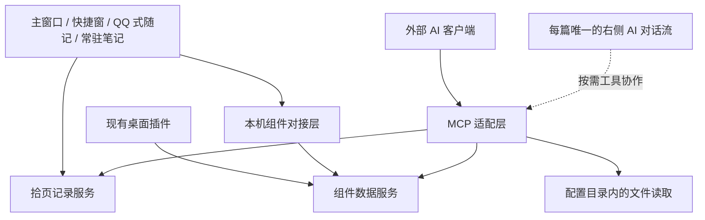

# 多入口记录与功能完善

2026-10-17 常驻记事本现按用户进一步说明收敛为“拾页便签”：按事情命名、待办长期修改、一窗多个标签，先搭前端与 UI，内容格式后议。独立前端/宿主已打开，试用快照/profile与正式库隔离；见 [试用说明](NOTES-UI-PREVIEW.md)。不把旧建议中的复杂项目管理/归档/日记联动一并视为本轮确认。

2026-10-16 常驻记事本补充：用户现已明确为“多标签便签草稿本”，自动保存并下次续写，使用拾页图文编辑、直接插图和排版。详见 [便签需求与接入方案](NOTES-REQUIREMENTS.md)。下文常驻记事本中的置顶、归档等仍属建议，不能因本次选择一并视为已确认或已实现。

2026-10-15 消息入口最新澄清见 [聊天会话专题](CHAT-JOURNAL-REQUIREMENTS.md)。早先“每次发送一条稳定记录”仅代表逐条消息有稳定身份，不等于每条成为普通日记；用户已确认每个会话连续空闲默认 5 小时（可调）才结篇，持续断续发言则继续本段。撤回长期只留提示，原文短暂用于重新编辑，底层格式仍待讨论。此次没有实现或迁移。

聊天窗口常规交互按用户要求优先参考微信/QQ 桌面端；与明确需求冲突则按用户规则处理，不为常见功能反复提问，也不据此决定底层存储。

图片与视频的添加、上传、查看均需有聊天软件式完整流程；新增明确外观需求为背景、透明度与气泡可自定义，整体保持克制。具体参考组合与可调参数仍在聊天专题讨论，未实施。

个人主页/资料编辑新增为聊天入口联动需求，和拾页共用当前 profile，长期信息的字段尚未决定。开源 UI 候选及原生 JS/React/Qt 的接入区别统一记录在聊天专题；本轮没有引入依赖或修改正式数据。

日期：2026-10-15。状态：整体需求与实现建议；基础快捷输入改进已进入 0.9.11，范围与运行验收见 [本轮交付](QUICK-CAPTURE-0.9.11.md)。AI、非线性和长期入口不因此视为完成。已纳入用户本次对入口、桌面组件、AI、文件读取与加密的进一步说明。

依据：用户本次提出完善拾页、提供多个入口；已重新读取本机便签目录中最新的《日记软件改进.txt》。本文只提取产品需求，不复制私人随想、日记正文或待办内容。需求原件保持原样。

2026-10-15 后续澄清：当前快捷窗口是主要写作入口，主窗口主要用于浏览、搜索和统计。设置中的分类顺序调整、标题正文导航、默认中文及 Ctrl 缩放记忆优先；先讨论需求，再实施。全局入口、首项默认“上一篇”、编辑初始焦点可选和 AI 起标题的新要求，统一记录在 [快捷窗口最新讨论稿](F:/agent规范/ui设计/方案/2026-10-15-拾页快捷窗口.md)。新要求优先于本文早先建议及旧文档中固定先聚焦正文的约定。

## 目标与入口分工

最新新增：快捷窗需要“下一篇”，到最新篇打开与新开窗口相同的选择弹窗；分割线问题澄清为前文变大、像有下划线，按 Setext 误解析路径修复新输入。每次唤回恢复中文、允许托盘常驻已由用户确认；开机启动另行设置。

最新需求以 [快捷写作、AI 对话与非线性日记需求](QUICK-WORKSPACE-REQUIREMENTS.md) 为准，后续交流持续更新该文件。用户已确定 IDE 式左正文/右 AI，每篇仅一条对话流，静态保存在该篇内作为日记的一部分，可主动摘录补充正文。快捷窗口优先，同时主窗口支持；模型和具体字段仍待讨论。另行提出的正文分块/分栏与局部独立编辑，用户看过三种预览后均不喜欢，已明确暂缓，不纳入当前实施顺序。

用户已明确需要主窗口、快捷小窗、QQ 聊天形式，以及现有桌面插件的联动（日历、待办、倒计时）。希望 AI 能通过 MCP 一类接口协作并读取自己的文件。云服务器同步仍在考虑；已确认不必为 AI 读取取消已有备份加密。

最新阶段要求：AI 右栏像 IDE 一样按钮开关、默认收起；目前先考虑基本功能与跨软件数据读写，提示词和上下文细则留后续，继续参考 TermLens。用户明确要把 AI 引入自己的各种软件以读取和写入数据，当前目标包含业务读写接口，不仅是聊天展示；具体工具路线见 [跨软件技术草案](F:/agent规范/软件技术路径/跨软件AI接入与数据读写.md)。当前仍在讨论/汇总阶段。

记录场景包括正式写日记、即时发出短句，以及持续数天或更久地编辑同一份项目笔记。各入口应能找到同一条已保存内容，并共享分类、标签、图片、搜索、历史与备份。

| 入口         | 用户实际要做的事                         | 当前证据                                     | 本次完善方向                                   |
| ------------ | ---------------------------------------- | -------------------------------------------- | ---------------------------------------------- |
| 日记主窗口   | 浏览、搜索、统计和回看记录               | 现有主页面、分类标签、相册与回顾             | 保持现有浏览能力；写作体验优先完善快捷窗口     |
| 快捷日记小窗 | 随时打开，快速写一篇日记                 | 已有独立 EXE、多开、独立外观及上一篇流程     | 复查多屏、滚动、上一篇首次点击、保存及焦点行为 |
| 聊天式随记   | 像向自己发消息一样，马上记下一句话或图片 | 尚无独立消息流界面                           | 新增消息时间线、输入框、发送状态和编辑入口     |
| 常驻记事本   | 长期维护某个项目、灵感或任务记录         | 主窗口可编辑日记，但没有明确的常驻笔记工作台 | 固定打开同一笔记、笔记列表、多开与关闭后恢复   |
| 手机入口     | 离开电脑仍可记录、查看和修改             | 已有安卓私有版及电脑 WebDAV 同步代码         | 实测手机和电脑往返、图片、编辑冲突及离线恢复   |
| AI 数据入口  | 按日期、分类或主题读取记录               | 已有版本化本机只读接口和结构化导出           | 新入口的内容可检索，并保留隐藏、删除与草稿边界 |

“聊天式随记”与 AI 对话分别保留明确入口及角色；最新已确认需要手动发起的 AI 对话，后台自动回复、自动整理不因此视为已确认。

## 已有能力与需要复查的问题

快捷窗自由下拉、独立背景与字体、多开、上一篇首次点击等，在 [0.9.5 交接](QUICK-CAPTURE-0.9.5.md) 中已有实现记录。最新便签再次提到相关问题，不能只凭旧验收判为已经解决，应在当前运行版本复查。

用户还提出以下体验要求：

- 切换显示器后，窗口、字体和缩放仍合适；重开记住选择，屏幕断开后窗口仍可见。
- 默认使用中文输入，限定为拾页窗口的行为；中文输入法确认候选词不能触发消息发送。
- 正文可以顺畅回到标题；方向键、退格和 Tab 的具体行为需结合选区和输入法验证，不能吞掉正常编辑操作。
- 目录浏览顺畅，定位后能接着写，不因刷新跳走或丢失光标。
- 图片粘贴、拖入、上传和显示连续，失败可恢复，保存后不闪回旧状态。

当前代码中的编辑器、保存队列、revision 冲突校验和媒体关联应继续复用。实际代码入口见 [功能索引](FEATURE-MAP.md)。

## 聊天式随记：建议的首版行为

1. 打开即可看到最近记录和输入框，不要求先填标题。分类可沿用默认值，也能切换；话题分组作为后续可选能力。
2. 建议 Enter 发送，Shift+Enter 换行；提供可见发送按钮，并遵守输入法组词状态。快捷键的最终选择不当作已经确认的偏好。
3. 文字、图片、文字加图片都可发送；允许连续发送多条。空白内容不生成记录。
4. 每条显示发送中、已保存或失败。服务端确认前保留输入；超时后重试同一请求，不生成第二份日记。
5. 点击消息可修改、查看时间和附件，也能到主窗口打开同一条记录。删除、恢复与编辑历史沿用统一机制。
6. 未发送草稿需要恢复方案，不能仅依赖窗口内存。实现时区分未发送草稿与已经入库的消息，不能把自动草稿变成正式日记。

首版建议每次发送对应一条稳定记录，而不是不断拼接改写一篇“今天的聊天全文”。这样可逐条检索、修改、关联图片及处理冲突；界面可按日期分组显示。是否需要把多条消息整理成正式日记，留作单独的显式操作。

## 常驻记事本：建议的首版行为

1. 显示笔记列表，支持创建命名笔记、置顶、打开已有笔记和归档。
2. 打开的是同一份持续编辑的内容，关闭再打开继续原笔记；不因启动窗口创建新日记。
3. 多开可分别固定不同笔记。若同时编辑同一笔记，按版本判断差异，冲突时保留输入并提供选择。
4. 支持正文、标题、图片和 Markdown 任务列表；项目先通过分类或标签组织。任务勾选不自动变成系统提醒或外部待办。
5. 笔记与随记可互相链接，主窗口和 AI 接口能找到它们；转换呈现方式时保留记录身份和来源。
6. 先解决长时间编辑的保存、恢复与历史检查点，再考虑复杂项目管理。

现有 TXT 便签继续作为原始资料。需要导入时，按文件预览并保留来源；长笔记默认完整保留为一份记录，不自动按每行或每个时间戳拆碎。

## 数据与兼容设计约束

采用共享记录、共享媒体和共享保存服务。入口只决定呈现与交互，不各自维护互相覆盖的正文副本。

- 主窗口、快捷日记、消息流、常驻笔记通过同一稳定 ID 打开记录。
- 消息与常驻笔记的类型、来源和关联元数据应显式保存。具体字段在实现前定义，并核对校验、编辑历史、导入去重、备份、开放数据和手机同步；当前仅往新对象随手加字段会被部分校验或投影忽略。
- 历史日记缺少新增类型字段时继续视为普通日记，不做全库重写。
- 默认列表和统计应区分正式日记、碎片消息和常驻笔记，另提供统一时间线；不能用新增消息数量冒充正式日记数量增长。
- 现有 Android 兼容同步协议不保证保留新类型语义。新增类型正式跨设备使用前，必须核对往返后身份、类型、日期、分类标签、图片和修改状态；界面能显示普通正文不等于这些语义均保全。
- AI 读取继续使用 [开放数据接口](OPEN-DATA.md) 的白名单、分页快照和访问锁；按需扩展类型与来源筛选。默认仍排除隐藏、草稿和删除内容。

当前数据模型见 [DATA-MODEL.md](DATA-MODEL.md)，同步现状与边界见 [SYNC.md](SYNC.md)。尚未决定公开部署或写入外部服务器。

## 建议实施顺序与完成标准

| 次序 | 可交付范围             | 完成标准                                                                                     |
| ---- | ---------------------- | -------------------------------------------------------------------------------------------- |
| 0    | 现有入口复查与问题复现 | 在隔离库记录多屏、中文输入、标题导航、字号、滚动、上一篇与图片问题；已有功能和新问题分别标明 |
| 1    | 聊天式随记             | 连发文字和图片、保存后重开、中文候选词确认、失败重试与多窗编辑均通过；主窗口打开同一条       |
| 2    | 常驻记事本             | 多天续写同一记录、多笔记切换、多开、恢复及历史检查点通过；现有便签未被自动改写               |
| 3    | 手机与 AI 接入核对     | 手机和电脑使用虚构样本往返，验证类型、正文、媒体、日期、修改及冲突；AI 能按范围读取新增记录  |

每次功能交付都应包含源码、必要的启动器构建、隔离验证、文档和正式运行版本核对。现有工作区已有大量未提交改动，继续保留，不 reset、clean 或自动切换分支。

上表是最初按记录入口排列的顺序。用户补充桌面组件与 AI 需求后，实施顺序以下节为准。未将所有建议都标记为用户已经确认，也没有把文档保存当作功能完成。

## 桌面插件：已经存在的接入基础

已只读检查现有项目 `E:\个人兴趣研究\桌面壁纸小组件` 的 AGENTS、README、API 与相关模块。该项目已有待办、周日程、关联倒计时、管理后台及本机 CRUD 接口，不需要在拾页再建立一份独立待办数据。

| 数据或入口           | 现有归属                                       | 对接原则                                             |
| -------------------- | ---------------------------------------------- | ---------------------------------------------------- |
| 日记、随记、常驻笔记 | 拾页记录服务；目前正式文件为 `data/diary.json` | 新前端复用记录 ID、保存队列、媒体和历史              |
| 待办                 | 桌面组件 `data/todos.json`                     | 拾页与 AI 调用组件 API；桌面组件继续保存唯一业务记录 |
| 日历安排             | 桌面组件 `data/events.json`                    | 现有能力是周日程；完整月历/跨月查询属于后续界面扩展  |
| 倒计时               | 桌面组件 `data/countdowns.json`                | 保留已有 eventId 关联，修改日程后继续解析同一来源    |
| 各类本机资料         | 原始文件所在目录                               | 搜索、按范围读取并返回来源；不要求搬入日记数据库     |

桌面组件 API 默认 `http://127.0.0.1:18877/api/v1`，需要本地令牌；拾页读取接口默认 `http://127.0.0.1:18765/api/open/v1`。对接层在服务端访问二者，前端不直接持有桌面 API 令牌，也不放宽跨域限制。

具体联动建议：

- 日记中可以手动将一句话创建为待办或日程；经用户授权后，AI 也能执行，并返回操作结果和原文关联。
- 待办、日程、倒计时卡片可跳回相关记录。关联保存为“来源系统、记录 ID、关系”，避免把整段正文反复复制到每个系统。
- 同一日程的桌面卡片与拾页视图读取同一条记录。界面刷新、进程未运行与修改冲突应明确显示。
- 自然语言中的时间先保留原文，再确定日期、时区与是否重复；未表达日期的事项不自动变成某一天的日程。

## AI 与 MCP：上下文聊天与工具接入

建议新增独立的本机工具接入层，分别适配拾页 API、桌面组件 API 和可配置文件目录。MCP 面向已有 AI 客户端提供这些能力；它本身不要求在拾页中内置模型服务。

MCP 首批能力建议：

| 能力         | 读取                                         | 写入                                                               |
| ------------ | -------------------------------------------- | ------------------------------------------------------------------ |
| 日记与随记   | 搜索、按日期或分类列出、单条全文及附件元信息 | 创建记录、按 revision 更新、追加批注                               |
| 常驻笔记     | 打开指定笔记、搜索项目内容                   | 更新指定段落或整篇，保留历史与版本检查                             |
| 待办         | 列表、完成情况                               | 新增、修改、完成，带已读取的版本                                   |
| 日程与倒计时 | 按日期列出、解析关联来源                     | 新增、修改、建立关联，带已读取的版本                               |
| 本机文件     | 搜索、按范围读取、返回路径及定位信息         | 读写是总目标，具体可写范围和操作随后定义；业务数据通过软件接口修改 |

实现要求：

- 文件可读范围在配置中明确，保留真实目录，不为接入而迁移资料。服务端校验解析后的路径，包括联接与符号链接，防止超出配置范围。
- 读取遵守现有访问锁、隐藏、草稿和删除规则；范围与过滤条件可由用户主动调整。
- 新增或修改任务、日程、日记时由业务服务校验，不直接编辑运行中的 JSON。组件 API 单项操作虽然允许省略 If-Match，AI 适配层仍应固定携带版本，避免多个 AI 或多个窗口互相覆盖。
- 写入操作记录来源、目标、变更及结果，返回新版本；后续提供撤销。操作记录默认不另存整段私密正文和密钥。
- 原始日记和文件中的文字属于资料，不能被当作改变工具权限或要求执行操作的命令。
- 自动安排、自动删除、后台持续管理属于单独功能，不由“可以协作”推定为已授权的持续操作。

QQ 式随记的消息流与“向 AI 提问”是两项功能。用户最新已明确希望增加上下文 AI 聊天入口、保存会话及主动摘录回日记；实施顺序和数据关系见最新需求文件。区分本人原文与模型回复，无需为此批量改动已有日记正文。

协议参考：[MCP 官方 SDK 的客户端、服务端与能力说明](https://py.sdk.modelcontextprotocol.io/get-started/first-steps/)。具体 SDK、传输方式与客户端接入方式在实现时选定并验证，不在当前需求阶段锁定版本。

## 加密与云端：当前结论及待定项

已经核对的事实：拾页正式 `data/diary.json`、媒体和桌面组件 JSON 本来就是本机明文；拾页完整备份 `.syvault2` 才是加密容器。应用访问锁是访问限制，与磁盘上的数据加密不同。

因此，AI 读取本机工作库无需取消备份加密。建议保留现有加密备份，同时通过业务接口和文件读取工具提供 AI 所需范围。MCP 不会自动将数据变成只在本机处理；实际读取结果是否交给外部模型由所用 AI 客户端及其调用范围决定。

下列事项仍待选择，不在本轮实施：

- 是否新增云服务器同步，以及继续采用安卓兼容 WebDAV 还是另设计跨端协议。
- AI 聊天支持哪些模型服务、具体消息字段与模型密钥配置；日记内唯一对话流及其归属已经确认。
- 是否增加本机工作库的磁盘加密；当前不提出取消已有备份加密。

## 更新后的建议实施顺序

1. **统一数据与操作契约**：固定记录身份、类型、来源关联、版本检查和工具权限；各项目保留自身数据归属。
2. **QQ 式随记与现有窗口体验**：完成即时输入与保存恢复，同时复查多屏、中文输入、标题返回和图片体验。常驻笔记复用同一基础，再提供固定笔记入口。
3. **桌面组件联动与 MCP**：先提供日记和文件的可控读取，再开放具备版本检查与操作记录的待办、日程、倒计时及日记写入；用隔离数据做完整联动验收。
4. **后续功能**：软件内日记上下文 AI 聊天已明确需要，最新建议顺序见 QUICK-WORKSPACE-REQUIREMENTS.md；云端/手机同步路线仍待选择。本文早先“先接工具再决定聊天框”的排序不再代表当前确定顺序。

本次仅保存需求和架构草案，没有修改两个软件的业务代码、正式数据、加密方式或云端配置。

## 2026-10-16 数据统一研究入口

用户要求本轮先讨论长篇、消息与图片/引用等资源的统一格式、时间归篇意义、Word 式正文插图、导出规则和自建云跨时间消息。UI 由另一对话继续处理，本轮不实施格式迁移。既有手打时间戳、五小时动态归篇和撤回原文短期保留约束继续有效；非线性分栏未恢复实施。需求与候选路径集中于 [数据统一调研](DATA-UNIFICATION-RESEARCH-2026-10-16.md)，最终 schema 和存储引擎仍待讨论。

## 2026-10-16 进一步澄清：朝花夕拾与需求/技术平衡

聊天记录与长篇一样有分类，用户可复用已有分类或另设聊天分类；图文内容尽量共用，聊天保留会话归属和消息信息。“朝花夕拾”改为现在回看过去并留下今天的评论：希望按间隔同时看多个历史年份/周期，不为每次重现复制完整正文；换间隔后旧评论仍须保留来源上下文。用户当前倾向评论不自动参加下一轮回看。长篇手打时间戳及图片插入时间也应提供定位，但旧数据缺时间不能编造。

头像/用户名尚未想好，微信接入暂缓，后续倾向自有安卓客户端。用户强调体验与技术可行性必须平衡；按实际适配和原型证据决定图文 schema、编辑器及数据库，不大改代替验证。最新需求、固定来源关联评论的 AI 建议、归篇解释和实施边界见 [朝花夕拾设计](MEMORY-REVISIT-DESIGN.md)。本轮仍只讨论与更新文档，未切换数据格式或改 UI；“整理成独立文章”不是用户已确认的必经操作。

## 2026-10-16 已确认：只读归篇、评论对象与契约草案

聊天归篇的正文只读，避免两边改出不同原文；修改只从原聊天端撤回/重新编辑，日记侧可看和评论。评论不作为朝花夕拾回看来源。用户已选择无引用时自动评论最近展示的一组旧记录，引用某条时默认只回复这一条；输入框显示正在评论对象并可切换。开始输入固定组、取消引用恢复原组等为 AI 交互建议，具体控件待 UI 对话接入。

[统一数据契约 v1](UNIFIED-DATA-CONTRACT-V1.md) 具体列分类、会话、时间、图文/媒体、只读篇目、评论及固定回看上下文，附机器 schema、虚构样本和当前模块适配表。本轮只读核对代码并校验设计，不改 UI/运行版/旧数据，不把草案当已接入功能。共用正文格式不要求立刻迁移 SQLite 或替换所有编辑器。

## 2026-10-16 当前根目录与剩余确认

用户确认后续以 D:/拾页 当前项目根目录工作。本轮已核对根目录三项 EXE 与 src/server、previews/telegram-chat 源码位置；未移动旧数据、启动新版或接管其他 UI 对话。数据工作继续与 UI 分工：关联契约已明确，后续适配按现有模块划分文件。

无引用关联最近组、引用只回复单条、输入框目标显示/切换、聊天归篇正文只读、评论不进回看均沿用确认。用户已选择撤回后重新编辑按重发时刻作为新消息，使用新发送时间/消息 ID；原评论保留原关联。回看组时间窗等细节可结合原型调整，当前不批量追问或锁死。见 [统一数据契约](UNIFIED-DATA-CONTRACT-V1.md)。

## 2026-10-16 已确认：按篇阅读，评论可标记消息与图片

用户明确区分评论显示单位与具体对象：仍按整篇日记查看，但可以标记到其中一条信息/消息或某张图片；查看评论时注明目标并能定位。整篇入口可留下总体评论；消息/图片引用不能扩展成针对整篇全部内容。数据契约补 CommentTarget 的 pageId、scope、recordId、blockId、occurrenceId，图片按这次出现定位，不只关联共享图片文件。

无引用评论最近回看组、有引用回复单条、聊天归篇正文只读、评论不进回看继续有效。同一评论在本篇命中多个目标时只展示/计数一次。具体标记样式由后续 UI 设计，当前只更新 [统一数据契约](UNIFIED-DATA-CONTRACT-V1.md)、机器草案及虚构样本，不改界面或旧数据。

## 2026-10-16 已确认顺序：富文本 → 数据结构 → 朝花夕拾

用户确认评论精确关联、按篇阅读的方向；要求先确认富文本优化和数据结构优化，再考虑朝花夕拾。完整范围/放行条件见 [三阶段计划](RICH-TEXT-DATA-IMPLEMENTATION-PLAN.md)。第一步独立开发库验证共享富文档、Markdown/中文输入、文中图片及保存往返；第二步接统一模型与基础接口、消息撤回/只读归篇/精确评论；第三步做回看查询与自动组评论。旧数据先不动，不要求现在迁移数据库。

本轮实测源码 package.json=0.9.20，正式 18765/api/health=0.9.18，开发 18766/api/health=0.9.19。D 盘有新接口设计和现有后端源码，但统一数据 v1 接口没有实现或接入运行；不得把文档更新说成软件/接口已升级。其他对话的入口切换有单独记录，本轮没有重试被拒切换。

## 2026-10-16 第一步开始与界面协作边界

用户已授权核对 D 盘切换后开始第一步；正式 API 已为 0.9.20，服务和常驻托盘位于 D:/拾页，正式数据仍沿用 F 盘。已新增独立图文试写原型：富文本与 Markdown 输入、文中图片原件及排版、同内容只读消息预览、独立试验库保存重开、字段保留检查与 4% 文字缩放。实施、支持矩阵及未验证项见 [图文试写](RICH-TEXT-STAGE1.md)。

用户随后说明另一会话正在操作界面。本会话停止窗口操作和重启，仅做代码、Node 模型/DOM/存储模拟检查；不通过其他工具绕过界面操作限制。正式编辑器/聊天 renderer 未替换，旧数据未转换；真实中文输入法和窗口验收待进行。统一数据接口仍为第二步，朝花夕拾仍为第三步。

## 2026-10-16 本轮继续与独立窗口授权

用户确认另一会话已结束，可操作独立试验窗口。第一步已补齐原件编解码、草稿版本冲突、导入中输入保护、原子回滚和导入前草稿/图片恢复，完整检查 317/317 通过；恢复副本仅用于试验草稿，不改变聊天撤回规则。实际 Edge 状态读取再次被 Computer Use 的浏览器 URL 校验拒绝，未绕过；真实 IME/窗口验收仍待进行。最新使用与边界见 [图文试写](RICH-TEXT-STAGE1.md) 和 [验证记录](validation/2026-10-16-rich-text-stage1.md)。旧数据和第二/三步范围不变。

## 2026-10-16 快捷长文入口与试写衔接澄清

用户再次强调，快捷窗口是日常最常用的长篇日记入口，询问试验页怎样测试、怎样与其结合。当前试验页仅测正文和图文往返，快捷窗口设置只新增跳转，正文和正式保存未接入。已在 docs/RICH-TEXT-STAGE1.md 补 R01–R06 人工试写清单，默认中文/热键/托盘/五小时光标滚动恢复等必须在真实快捷窗口验收。

AI 实施建议：优先做隔离快捷窗口中新建测试篇的富文档编辑器接入，并补最小版本化正文/媒体保存适配；沿用原入口及分类、标题、上下篇、自动保存和后台恢复。不把试验页右侧预览带成正式快捷窗默认布局；AI 栏仍默认隐藏。旧篇不自动转换，后续主窗口/聊天共用内容层，朝花夕拾继续第三步。该建议尚未作为已实现功能交付，本轮只核对代码与补说明，不改代码或旧数据。

## 2026-10-16 用户确认：继承快捷长文四项核心

用户明确本轮关键是快捷键插时间戳、分割线、智能自动换行、插入图片预览，继承并升级即可。以这四项作为新富文本接入快捷窗口的首要验收，不以独立试验页或扩展功能替代实际长文流程。沿用当前热键/格式/时区、句中/选区与段末时间插入语义、缩进开关和中文候选保护；分隔不改前文；图片确认/取消与键盘操作继续保留，升级光标处文中预览、原件和独立放大。自动保存、五小时恢复、光标滚动、默认中文和缩放记忆仍需回归，旧日记不批量转换。具体已核对模块与验收矩阵见 docs/RICH-TEXT-STAGE1.md。本轮为需求确认/代码核对，没有宣称四项已迁移完成。

## 2026-10-16 升级继承审计与长文时间澄清

用户要求先了解历次快捷窗升级记录/需求，保持既有行为，只在此基础上增加文中图片适配，并适配统一数据结构。本轮读原便签日记软件改进.txt、基础交接、0.9.5/0.9.9/0.9.11–0.9.17 记录与现行源码，形成 docs/QUICK-RICHDOC-INHERITANCE.md 及 docs/contracts/quick-richdoc-inheritance-v1.json 共 40 项基线。后续必须逐项验证新侧，不能把旧路径测试或试验页当已继承；旧路径重点回归 127/127 通过。本轮未换编辑器、未改服务/正式数据、未重启程序。

用户追问手动时间戳如何计算、图片是否有插入时间。确认可见时间仍由用户手打/快捷键插入，不自动给长文逐段打点。原型新文件插入图片已有隐藏 UTC insertedAt 和 occurrenceId，旧媒体上传/拍摄/修改时间不能代替正文出现时间，旧图未知不补造。按明确手打时间行建立段落锚点、正文继承最近锚点、缺时区推定及图片回看展示策略为 AI 建议，未宣布已实现或全部选定；实际插图时间与正文表达时间并存。细则见继承基线第八节。
